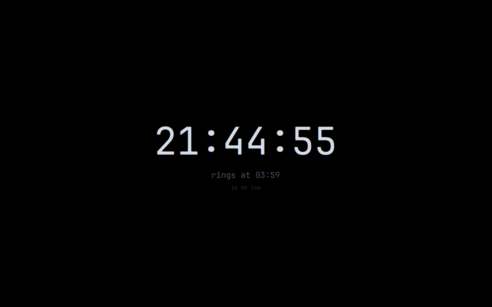

# Get The F Up



An Omarchy plugin that turns your machine into an **alarm clock instead of a
computer**.

Arm it with a time and a challenge. The screen goes black with a clock, the display
dims, and at the ring time an alarm sounds that only stops when you complete the
challenge. You can also leave early by completing it.

> **Status:** in development. See [`SPEC.md`](./SPEC.md) for the full design and
> [`docs/implementation-plan.md`](./docs/implementation-plan.md) for the phases.

---

## What it does

- **Fullscreen sleep screen** on every monitor — black background, a large ticking
  clock, the ring time, and a live countdown. Claude Code TUI styling.
- **Dims the display** via hyprsunset gamma, which reaches both your laptop panel and
  an external monitor (the external one has no DDC/CI, so backlight control can't).
- **Forces the alarm volume up** to a level you configure, on a sink you configure.
- **A challenge you cannot skip** — math, typing, memory, or a camera check that
  forces you to get up and turn the light on. N complete challenges to exit, before
  or after the ring.
- **Locks the machine down** while active — every behavior (notifications, media,
  bar, window switching, all monitors) is individually toggleable.
- **Restores everything** on exit: brightness, gamma, volume, mute, idle behavior.
- **Day alarms** — scheduled alarms for the rest of your day (once, weekdays, any
  set of days) that ring with a fullscreen title and a challenge, without the sleep
  screen, the dimming or the lockdown. Missed by under an hour (suspend)? It rings
  on wake.
- **A custom title** on the ring screen for every alarm, WAKE UP by default.
- **Test modes** — a zero-side-effect preview, and a full-fidelity dry run with an
  accelerated timer so you can see (and hear) the alarm state without waiting.

---

## Requirements

Omarchy 4 (Quattro shell). The plugin calls these external tools, all of which ship
with a stock Omarchy install:

- `hyprctl`, `hyprsunset` — display dimming and gamma
- `brightnessctl` — backlight
- `pactl`, `wpctl` — volume and output selection
- `pw-play`, `paplay` or `mpv` — alarm playback (first one found)
- `ffmpeg` — camera capture, only when the light gate is enabled
- `systemd-run`, `systemd-inhibit` — crash watchdog and idle/sleep inhibition
- `jq`, `omarchy-notification-send`

## Install

```bash
omarchy plugin add https://github.com/heitorsDev/get-the-f-up.git --enable
```

## Remove

```bash
omarchy plugin remove io.github.heitorsdev.get-the-f-up
```

Your settings (`~/.config/omarchy/get-the-f-up/`) and history
(`~/.local/state/omarchy/get-the-f-up/`) are left in place; delete them by hand.

---

## CLI

The plugin exposes a headless IPC target, so external bars and scripts can drive it:

```bash
omarchy-shell get-the-f-up status
omarchy-shell get-the-f-up arm   '{"time":"07:30","challenge":"standard","reps":3}'
omarchy-shell get-the-f-up arm   '{"duration":"45m","challenge":"thorough","reps":2}'
omarchy-shell get-the-f-up open  '{}'
omarchy-shell get-the-f-up history
omarchy-shell get-the-f-up preview
omarchy-shell get-the-f-up dryrun

# day alarms
omarchy-shell get-the-f-up alarms
omarchy-shell get-the-f-up addalarm '{"time":"14:00","title":"standup","days":[1,2,3,4,5]}'
omarchy-shell get-the-f-up removealarm <id>
```

`arm` takes an optional `"title"` for the ring screen's headline.

`disarm` is rejected unless the challenge is done — the point of the mode is that
the only exits are N completed challenges or the crash watchdog.

---

## Configuration

`~/.config/omarchy/get-the-f-up/config.json` — every key has a default, so a partial
file is valid. See [`SPEC.md`](./SPEC.md#16-configuration-reference) for the full
reference. Day alarms are kept in `~/.config/omarchy/get-the-f-up/alarms.json`.

---

## Development

```bash
npm test                # node --test tests/*.test.js
omarchy plugin validate .
```

---

## License

MIT
